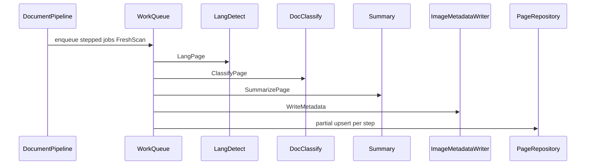

# Plan: Lang detect, classify, summary → image metadata (resource-safe)

## Goal

After crop/enhance (Save path), run on-device NLP:

1. Language detection  
2. Document classification  
3. Summary (per-page + batch)  
4. Persist to DB **and** standard image metadata  
5. Hard hardware limits so devices do not lag / ANR / OOM  

Scope: engine + storage metadata only (not Capture/Import UI).

See also shared **WorkQueue** (Save NLP + 7-day suggest): [resource-limits.md](resource-limits.md).



---

## Locked choices

| Topic | Choice |
|-------|--------|
| Lang detect | Text-first: Unicode script histogram + compact detector on OCR string (CPU). No extra vision model for lang. |
| Classify | Heuristic taxonomy v1 (promote current tag engine) → `doc_type` + tags; no cloud VLM. |
| Summary | Extractive always (max 500 chars). Generative if weights exist **and** `systemOk()` (no min-RAM class). |
| Per-image metadata | DB fields + EXIF `ImageDescription`/`UserComment` + XMP `docscan:` + sidecar `{image}.docscan.json`. |
| Concurrency | Shared priority `WorkQueue` (FreshScan > UserSave > Suggest > Deferred); serial; newer `enqueuedAt` first within band. |
| NLP image size | Long edge ≤ **1600px** if any bitmap path needed. |
| Timeouts | Per-step (lang/classify 2s, extractive 2s, generative 8s, OCR 15s) — see resource-limits. |
| Memory | Fixed budgets only; generative gated by OS lowMemory + thermal — **not** free-RAM MB or min total RAM. |

---

## Data model extensions

Add to `Page` / `PageEntity` (see also `docs/data-model.md`):

| Field | Type |
|-------|------|
| `ocr_lang` | string (BCP-47) |
| `ocr_lang_confidence` | float |
| `doc_type` | string (primary) |
| `doc_type_confidence` | float |
| `doc_types_alt` | string[] |
| `summary` | string? (per-page) |
| `summary_source` | `extractive` \| `generative` |
| `nlp_version` | string |
| `metadata_written_at` | instant? |

Batch keeps aggregated `summary` / `tags`.

### Sidecar `{stem}.docscan.json`

```json
{
  "docscan": 1,
  "page_id": "...",
  "lang": "en",
  "lang_confidence": 0.82,
  "doc_type": "invoice",
  "tags": ["invoice"],
  "summary": "...",
  "summary_source": "extractive",
  "nlp_version": "1.0.0"
}
```

EXIF/XMP write failures must **not** fail Save (DB + sidecar suffice).

---

## Modules

### Android

- `engine/lang/LangDetectEngine.kt`
- `engine/classify/DocClassifyEngine.kt` (from `HeuristicTagEngine`)
- `engine/summary/SummaryEngine.kt` (page-level + gates)
- `engine/metadata/ImageMetadataWriter.kt`
- `engine/runtime/WorkQueue.kt`, `WorkJob.kt`, `DeviceCapability.kt`
- Stepped enqueue from `DocumentPipeline`; suggest via same queue

### iOS

Mirror under `ios/DocScan/Engine/` with Vision OCR text → same NLP; ImageIO for metadata; serial queue.

### Docs to add/update

- `docs/engines/contracts.md` — new APIs  
- `docs/data-model.md` — fields above  
- `docs/engines/resource-limits.md` — copy of guardrails  

### Contract additions

```text
detectLanguage(ocrText) -> LangResult
classifyDocument(ocr, image?) -> DocTypeResult
summarize(ocrText, mode) -> SummaryResult
writeImageMetadata(path, PageNlpMetadata) -> ok|skipped
```

---

## Resource guardrails

- NLP never on main/UI thread  
- Max 1 NLP job; Save UI shows non-blocking progress  
- Thermal / low-memory → extractive-only, skip optional work  
- Batch summary input truncated to **8k** chars  
- Cancel on `onStop` / task cancel  
- Re-run NLP on re-edit only if image hash or enhance preset changed  

---

## Implementation order

1. Docs (contracts, data-model, resource-limits)  
2. `DeviceCapability` + `EngineExecutor` (Android, then iOS)  
3. Lang detect → pipeline  
4. Doc classify → `doc_type` + tags  
5. Per-page summary + gated generative  
6. `ImageMetadataWriter` + sidecar + entity fields  
7. Repository search includes `doc_type` + `summary`  
8. Unit tests (en/vi/zh samples, invoice classify, timeout fallback, sidecar round-trip)  
9. iOS parity  

## Out of scope

- Training/download of large generative models beyond optional asset drop-in  
- CS `.data` decrypt for classify  
- Capture/Import UI  
- Cloud NLP  

## Todos

- [x] nlp-docs  
- [x] nlp-runtime-guards  
- [x] nlp-lang-classify  
- [x] nlp-summary-page  
- [x] nlp-image-metadata  
- [x] nlp-tests-ios-parity  
